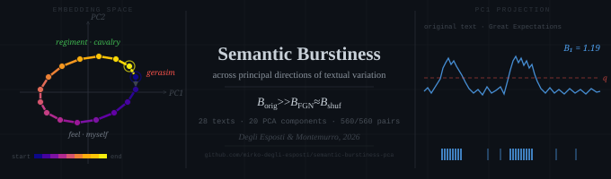

Code and data for

> M. Degli Esposti, M. A. Montemurro
> **Semantic burstiness across principal directions of textual variation**
> submitted to *Physica A: Statistical Mechanics and its Applications* (2026)
> arXiv: *to be added*

Every number, table and figure in the paper and its Supplementary Material is
produced by the scripts in this repository from the texts in `data/corpus_v2/`.

## Overview

Each text is mapped token by token onto a trajectory of pre-trained word embeddings
(GloVe 6B, 300d). PCA of the trajectory gives text-specific directions of semantic
variation; thresholding the projection on component *k* at its *q*-quantile defines
events, and the coefficient of variation of the inter-event times gives a
component-resolved burstiness spectrum
B<sub>k</sub> = σ<sub>τ</sub>/⟨τ⟩ (B = 1 for a Poisson/geometric process).

The original is compared with two controls:

- **word-shuffled null**: a random permutation of the tokens, with the same embedding
  covariance, PCA eigensystem and marginal projected distributions, but no temporal
  order (20 realisations per text);
- **FGN surrogate**: a Zipf-preserving, long-range correlated surrogate
  (Montemurro & Degli Esposti, *Physica A* 683, 131227, 2026) whose rank sequence matches
  the DFA exponent of the original, projected on the *original* PCA axes.

**Main result** (28 texts, components k = 1…20, q = 0.95): the original exceeds both
controls in all 560 text–component pairs; the mean ratio B<sup>orig</sup>/B<sup>shuf</sup>
over pairs is 1.26 (per-text means 1.15–1.44), while B<sup>FGN</sup>/B<sup>shuf</sup> =
1.001 ± 0.001, i.e. the two controls are indistinguishable. The ordering holds for every
q from 0.60 to 0.95 and for 98.8% of pairs at q = 0.99. Autocorrelation and DFA of the
projections separate the originals from both controls in the same way. All quoted
numbers are collected in [`results_v2/paper_numbers.md`](results_v2/paper_numbers.md)
and [`results_v2/paper_numbers_extra.md`](results_v2/paper_numbers_extra.md).

## Installation

```bash
conda create -n semburst python=3.11 && conda activate semburst
pip install -e .
```

Dependencies (from `pyproject.toml`): numpy, scipy, scikit-learn, pandas, matplotlib,
gensim, and `nltk==3.9.1`. The NLTK pin is deliberate: the tokeniser changed in 3.10, and
with it every token count. NLTK's `punkt` data is downloaded on first use. No GPU is
needed.

### Word vectors

The GloVe vectors are not redistributed. Download `glove.6B.zip` from
<https://nlp.stanford.edu/projects/glove/> and place `glove.6B.300d.txt` in
`data/vectors/`. The file is checked on first load
(SHA-256 `91125602f730fea7ca768736c6f442e668b49db095682bf2aad375db061c21ed`) and a gensim
`.kv` cache is written next to it.

## Reproducing the paper

Run everything from the repository root (paths are relative to the working directory).

```bash
# 1. corpus tables: results_v2/corpus_{burstiness,acf,dfa}.csv  (~3.5 min on a laptop CPU)
python scripts/run_corpus.py data/corpus_v2 --out results_v2 --force

# 2. numbers quoted in the paper
python scripts/paper_numbers.py data/corpus_v2 --results results_v2 --out results_v2/paper_numbers.md \
    --showcase war_and_peace.txt origin_of_species.txt great_expectations.txt ulysses.txt
python scripts/paper_numbers_extra.py data/corpus_v2        # genre, M-dependence, q = 0.99 events, pole tables

# 3. figures (300 dpi)
python scripts/make_figures.py --results results_v2 --out figures_v2 --dpi 300
python scripts/run_main_figures.py data/corpus_v2 --out figures_v2 --dpi 300 \
    --texts war_and_peace.txt origin_of_species.txt great_expectations.txt ulysses.txt
python scripts/run_text.py data/corpus_v2/{war_and_peace,origin_of_species,great_expectations,ulysses}.txt \
    --out figures_v2 --dpi 300

# 4. robustness checks of the FGN surrogate (Supplementary Material)
python scripts/filtered_rank_dfa.py data/corpus_v2 --manifest data/corpus_v2/manifest.csv
python scripts/fgn_filtered.py      data/corpus_v2 --manifest data/corpus_v2/manifest.csv
```

The per-text results of the paper are included in `results_v2/runs/` and act as a cache:
without `--force`, `run_corpus.py` only rebuilds the corpus tables from them. Use
`--texts a.txt b.txt` to process a subset.

| Paper | Produced by | Output |
|---|---|---|
| Corpus table, all corpus-level numbers | `run_corpus.py`, `paper_numbers*.py` | `results_v2/` |
| Fig. 1 (IET distributions, *War and Peace*), Figs. 5–6 (ACF/DFA, *Great Expectations*), per-text SI figures | `run_text.py` | `figures_v2/<text>/` |
| Fig. 2, SI quantile sweep (2×2 panels) | `run_main_figures.py` | `figures_v2/panel_*.png` |
| Figs. 3–4, SI corpus ACF and ratio distributions | `make_figures.py` | `figures_v2/fig*.png`, `figures_v2/acf_corpus_*.png` |
| SI: filtered-rank DFA, FGN matched after filtering | `filtered_rank_dfa.py`, `fgn_filtered.py` | `results_v2/filtered_rank_dfa*`, `results_v2/fgn_filtered*` |

## Corpus

28 English-language works from Project Gutenberg (public domain): 20 novels and 8
non-fiction works (Darwin, Wallace, Mill, Smith, James, Russell, Twain's *Life on the
Mississippi*), from 70,817 to 564,609 tokens. Four texts are used as showcase examples
throughout the paper: *War and Peace*, *On the Origin of Species*, *Great Expectations*
and *Ulysses*.

`data/corpus_v2/` contains the cleaned texts, rebuilt by

```bash
python scripts/build_corpus.py
```

from the Gutenberg sources in `data/pg/text/` (header, footer and licence already
removed), following `data/corpus_v2/manifest.csv`: one row per work with Gutenberg ID,
author, translator, year of first publication, genre, and the word sequences that mark
the beginning and end of the body (prefaces, contents, appendices, indices and notes are
excluded). `build_report.csv` records the resulting sizes and residual checks.

## Parameters and reproducibility

All parameters are in a single frozen dataclass, `src/semburst/config.py`: the 100 most
frequent word types and types with frequency < 5 are removed, K = 20 components,
q ∈ {0.60, 0.70, 0.80, 0.90, 0.95, 0.99}, 20 shuffled realisations, fixed seeds.

The pipeline is deterministic and the tables are reproduced identically on macOS/arm64
and Linux/x86-64. PCA is computed from the explicit covariance matrix with `eigh` and
the scikit-learn sign convention (the sign matters, since events are
`projection > threshold`), rather than through a solver-dependent library call.
Moving a single event changes B by about B/n, with n ≈ (1−q)M events; differences of this
size between machines or library versions are not errors. The statistical standard error
of B is ≈ B/√n, i.e. 1–3.5% at q = 0.95 and 2–8% at q = 0.99 across the corpus.

## Repository layout

```
src/semburst/        the analysis package
  config.py            all parameters (Params, DEFAULT)
  text.py              Gutenberg stripping, NLTK tokenisation, frequency filter
  embed.py             word vectors and embedding trajectory (OOV tokens dropped)
  pca.py               covariance + eigh, deterministic sign convention
  burst.py             events, inter-event times, burstiness, shuffled null
  surrogates.py        Zipf-preserving FGN surrogate, alpha matched by bisection
  dfa.py, acf.py       detrended fluctuation analysis, autocorrelation
  pipeline.py          analyse_text(): one PCA and one FGN realisation per text,
                       shared by the burstiness, ACF and DFA tables
  figures.py
scripts/             command-line entry points (see above)
data/corpus_v2/      the 28 texts, manifest.csv, build_report.csv
data/pg/text/        the Project Gutenberg sources of the 28 texts
results_v2/          result tables and paper numbers
figures_v2/          figures of the paper
```

## Citation

Please cite the article and, for the code and data, this archive (see
[`CITATION.cff`](CITATION.cff)):

```bibtex
@article{DegliEspostiMontemurro2026,
  author  = {Degli Esposti, Mirko and Montemurro, Marcelo A.},
  title   = {Semantic burstiness across principal directions of textual variation},
  journal = {Physica A: Statistical Mechanics and its Applications},
  year    = {2026},
  note    = {submitted}
}
```

The FGN surrogate:

```bibtex
@article{MontemurroDegliEsposti2026,
  author  = {Montemurro, Marcelo A. and Degli Esposti, Mirko},
  title   = {A {Z}ipf-preserving, long-range correlated surrogate for written
             language and other symbolic sequences},
  journal = {Physica A: Statistical Mechanics and its Applications},
  volume  = {683},
  pages   = {131227},
  year    = {2026},
  doi     = {10.1016/j.physa.2025.131227}
}
```

## License

- Code: [MIT License](LICENSE).
- Result tables, figures and corpus manifest: [CC BY 4.0](LICENSE-DATA).
- Texts: public domain (Project Gutenberg).
- GloVe vectors: not included; see the [Stanford NLP page](https://nlp.stanford.edu/projects/glove/).

Authors: Mirko Degli Esposti ([ORCID 0000-0003-0316-3449](https://orcid.org/0000-0003-0316-3449)),
Marcelo A. Montemurro ([ORCID 0000-0003-0893-8530](https://orcid.org/0000-0003-0893-8530)).
